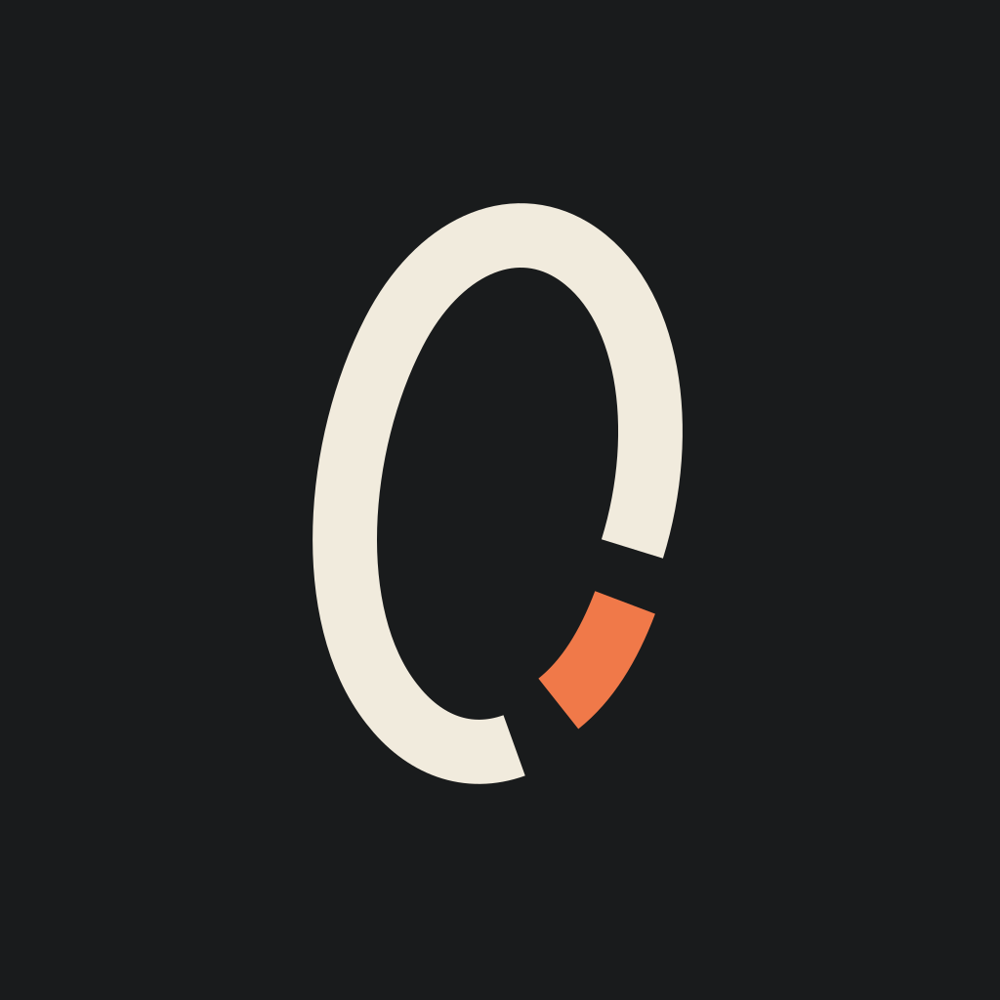
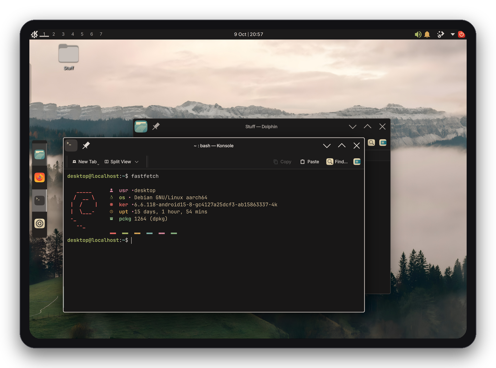
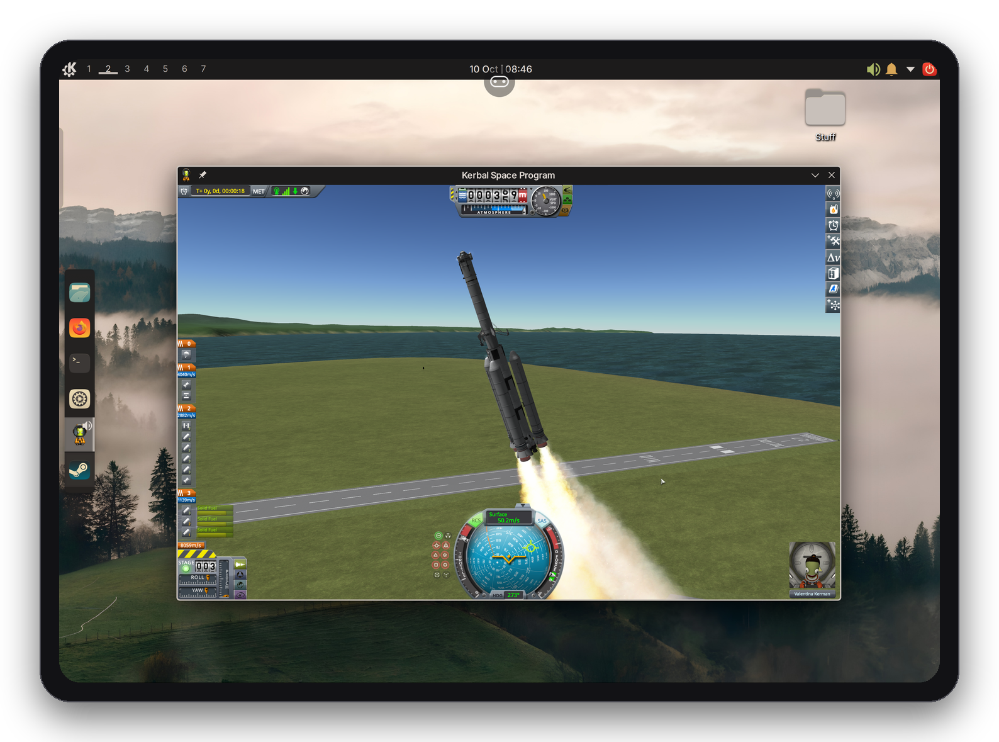
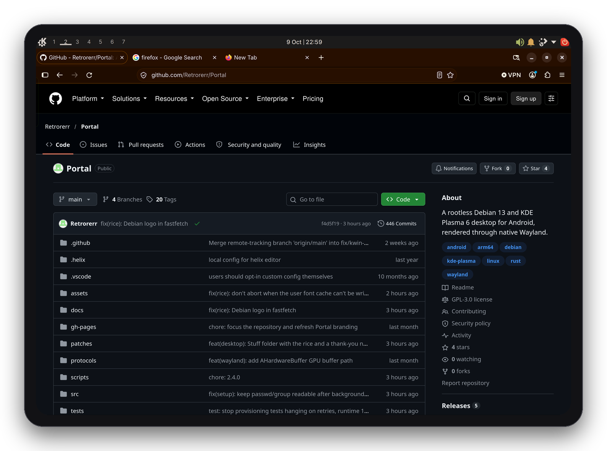
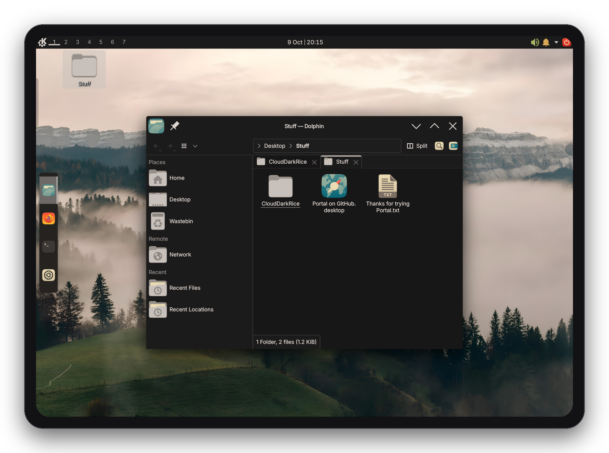

<p align="center">
  
</p>

<h1 align="center">Portal</h1>

<p align="center">
  A real Linux computer on your Android phone or tablet.<br />
  Debian 13 and KDE Plasma 6, running on the device's own GPU.
</p>

<p align="center">
  <a href="https://github.com/Retrorerr/Portal/releases"></a>
  <a href="https://github.com/Retrorerr/Portal/actions/workflows/build.yml"></a>
  <a href="LICENSE"></a>
  
</p>

<p align="center">
  <a href="https://github.com/Retrorerr/Portal/releases/latest/download/Portal.apk" title="Download Portal">
    
  </a>
</p>

<p align="center">
  
</p>

Portal is one app. Install it, tap through a short setup, and a few minutes later you're on a full KDE Plasma desktop. You don't need Termux, root, a PC or an unlocked bootloader. Nothing is streamed from somewhere else: Linux and its apps run on the phone itself, drawn by its GPU, with sound, keyboard, mouse, camera and clipboard all connected to Android.

Plug the phone into a monitor and it's a desktop computer, with the phone in your hand as the touchpad.

## Features

### Monitors and TVs

Connect a monitor or TV and the desktop moves onto it, sized for that screen. The phone becomes a touchpad, a keyboard, or a full game controller. You can also leave Portal and use Android as usual while the desktop keeps running on the big screen.

1. Connect the monitor with a USB-C to HDMI cable or a dock, or cast to a wireless display.
2. On the desktop, open the Portal pill, then **Portal settings → External display**, and pick the monitor.
3. The first time, Portal asks for one or two Android permissions. Allow them, and you're done.

Tap **Return** on the touchpad to bring the desktop back to the phone.

Samsung DeX does something similar for Android apps. Portal gives you a Linux desktop instead, on more phones:

| | Portal | Samsung DeX |
|---|---|---|
| **On the monitor** | KDE Plasma with Linux desktop apps: Firefox, LibreOffice, GIMP, Krita, Steam | Android apps in windows |
| **Devices** | Snapdragon phones and tablets of any brand, including phones that normally only mirror their screen | Samsung Galaxy phones and tablets |
| **In your hand** | Touchpad, keyboard or a full game controller | Touchpad and keyboard |

<!-- photo: phone as touchpad in front of a monitor showing Plasma -->

### Workspaces

Keep several separate Linux setups on one device, each with its own apps, files and settings: one for work, one for games, one for someone else who borrows the tablet. Switch between them from the veil in a few seconds, without restarting Portal. Touch and hold a workspace to delete it.

<!-- screenshot: Workspaces card -->

### GPU acceleration

Plasma's compositor draws on the device's Adreno GPU and hands each frame straight to Android's display. There's no VNC and no extra copy in between. Firefox, Chromium, Electron and Flatpak apps get GPU acceleration too.

Video uses the device's own hardware decoder, the same one Android's apps use. That cuts the cost of video dramatically: 4K YouTube in Firefox plays as smoothly and efficiently as it does in a native Android app. It works in Firefox, Chromium, mpv, VLC and GStreamer apps, for H.264, HEVC, VP9 and AV1.

### Gaming

Pick Steam during setup and you get the ARM64 Steam client. Native ARM64 games run directly, x86 Linux games run through Box64, and Windows games run through Proton. Controllers connected to Android show up as Xbox controllers. Without one, there's an on-screen controller you can lay out per game, and per-game frame-rate caps. With the desktop on a monitor, the whole phone becomes the controller.

<p align="center">
  
</p>

<p align="center"><sub>Kerbal Space Program from Steam, an x86-64 Linux game running through Box64</sub></p>

### Android integration

- **Sound** plays as ordinary Android media, so volume keys, Bluetooth headphones and equaliser apps all work.
- **Camera and microphone** work in Linux apps, for example for video calls in Firefox.
- **Files:** drag files in from another Android app, add them with Android's picker, or save files from Linux to anywhere Android can.
- **Typing:** the clipboard is shared. Use Android's keyboard, or Portal's own desktop keyboard with real Ctrl, Alt and F-keys.
- **Keyboard, mouse, touchpad:** USB or Bluetooth. Plasma switches between tablet and desktop mode by itself.
- **Background:** leave Portal and the desktop keeps running. Come back and your windows are where you left them.

<table>
  <tr>
    <td width="50%"></td>
    <td width="50%"></td>
  </tr>
  <tr>
    <td align="center"><sub>Firefox</sub></td>
    <td align="center"><sub>Dolphin and the Stuff folder</sub></td>
  </tr>
</table>

## Apps

**Included:** Firefox, Discover, Dolphin, Konsole, Kate, Okular, Gwenview, Ark, KCalc and System Settings, plus command-line tools such as `git`, `htop`, `nano`, `curl` and `man`.

**Optional**, picked during setup or added later from **Apps** on the veil: Claude, ChatGPT, LibreOffice, Thunderbird, GIMP, Krita, Inkscape, VLC and Steam.

**Anything else** comes from Discover (Debian packages and Flathub) or `apt`. You're the `desktop` user, and `sudo` works without a password:

```bash
sudo apt install gnome-calculator
```

Third-party arm64 `.deb` files and APT repositories work too. Flatpak apps keep their sandbox and get the GPU. AppImages and other portable apps open with **Open with Portal** in Dolphin, or `portal-run <path>`.

## Requirements

- **An Android phone or tablet with a Snapdragon chip** (Adreno GPU), 64-bit.
- **About 6 GB free.** Debian itself is roughly a 1 GB download.
- **8 GB of RAM or more** is comfortable for Firefox and a few apps.
- **Optional:** a keyboard and mouse, and a monitor. Touch works, but a desktop is easier with them.

Portal is developed on a OnePlus Pad 3 and a OnePlus 15. Other Snapdragon devices should work, but most are untested. Devices with Mali, PowerVR or Xclipse GPUs only get a slow software fallback for now; proper support is planned.

## Getting started

1. On your phone or tablet, tap **[Download Portal](https://github.com/Retrorerr/Portal/releases/latest/download/Portal.apk)** and install the APK. Allow installs from your browser if Android asks.
2. Open Portal, pick a theme, interface size and any extra apps.
3. Tap **Begin Install**. Setup takes a few minutes on a fast connection, and you can leave the app while it works. If it gets interrupted, open Portal again and it carries on.
4. Swipe up to enter your desktop.

Portal updates itself. When there's an update for Portal, its graphics drivers or Debian's packages, the veil shows it.

The [user guide](docs/user-guide.md) covers everything in more detail.

## Early days

Portal is a young project, tested on a handful of devices, so expect rough edges, especially on hardware nobody has tried yet. Reports are what get those fixed.

On the desktop, open the Portal pill and tap **Report**:

- **Report a bug** opens a prefilled GitHub issue. **Save logs** writes logs you can attach, with personal details removed where Portal can spot them.
- **Share what works** tells us how each part ran on your device. "Everything worked" is just as useful as a bug.

Portal uploads nothing on its own. If you'd rather write it up yourself, [open an issue](https://github.com/Retrorerr/Portal/issues/new/choose) with your device, Android version, Portal version and what happened.

## Good to know

<details>
<summary><b>Shortcuts and staying alive in the background</b></summary>

Android can catch shortcuts like `Alt+Tab` or `Ctrl+C` before Linux sees them. Turn on Portal under **Android Settings → Accessibility → Downloaded apps** to fix that. It only forwards key presses and doesn't read the screen. It also makes Android far less likely to close the desktop in the background.

If the switch is greyed out, open Portal's **App info**, tap **⋮** and choose **Allow restricted settings**. Android 13 and newer does this for apps installed outside an app store.

</details>

<details>
<summary><b>Android files</b></summary>

Grant **All files access** to open shared storage from Linux. Fully close and reopen Portal, then open `/android` in Dolphin. Downloads are in `/android/Download` and photos in `/android/DCIM`. Debian itself lives in Portal's private storage.

</details>

<details>
<summary><b>Logging out, and uninstalling</b></summary>

Logging out, or shutting down from Plasma, closes the desktop and Portal with it. Swiping Portal away from recents does the same.

**Uninstalling Portal deletes every workspace and everything in them**, so copy out anything you care about first.

</details>

<details>
<summary><b>Known limitations</b></summary>

- There's no systemd, so `systemctl`, `timedatectl` and similar tools don't work. Apps that only run as systemd services need starting by hand.
- Only arm64 packages install with `apt`. x86 programs need Box64 or FEX.
- Android can stop apps in the background. Long downloads or builds are safest with Portal on screen, or with the accessibility switch above turned on.
- If the whole desktop vanishes under heavy load, Android's child-process limit is the likely cause. Some devices can turn it off under **Developer options → Disable child process restrictions**.
- Sites that need Widevine DRM, such as Netflix, don't play. There's no Widevine for ARM64 Linux.

</details>

## How it works

```text
Android (display · touch · keyboard · audio · camera · files)
   │
Portal app (Rust host + Compose UI)
   │  GPU frames: KWin → Mesa (freedreno / Turnip) → Android buffers
   │
Debian 13 under tawcroot (rootless)
   │
KDE Plasma 6 and your Linux apps
```

Debian runs under tawcroot, Portal's rootless engine, which translates Linux file paths and permissions inside each process so nothing needs root. Older kernels fall back to a patched PRoot. KWin renders on the GPU through Mesa and hands finished frames straight to Android, and a simpler Smithay-based renderer stays in as a fallback. Audio goes through PipeWire to an AAudio stream opened in Portal's own process, which is why Android treats it as normal media.

More detail: [architecture](docs/architecture.md), [Debian provisioning](docs/debian-provisioning.md), [user guide](docs/user-guide.md).

## Building

You'll need Rust, the Android SDK and NDK, and the vendored `xbuild`:

```bash
git clone https://github.com/Retrorerr/Portal.git
cd Portal
cargo install --path patches/xbuild/xbuild --force
x build --release --platform android --arch arm64 --format apk
```

`scripts/build_android_variants.sh` (or `.ps1` on Windows) builds both variants:

- **Portal** (`app.polarbear.portal`) is the normal app. Its build comes out unsigned, so sign it before installing.
- **Portal Debug** (`app.polarbear`) has extra diagnostics and a badged icon, and installs alongside Portal with its own separate Debian.

Before sending changes, run `cargo test --tests`, and format only the files you changed with `rustfmt`. See [CONTRIBUTING.md](CONTRIBUTING.md) for the rest, and [SECURITY.md](SECURITY.md) for reporting security issues privately.

## Credits

Portal is a fork of [Local Desktop](https://github.com/localdesktop/localdesktop.github.io), and its history and GPL-3.0 license are kept intact. The GPU path builds on [lfdevs' Anland](https://github.com/lfdevs/anland-termux) KWin work and Mesa's freedreno and Turnip drivers. Hardware video builds on lfdevs' [termux-va](https://github.com/lfdevs/termux-va) and [Mesa for Android containers](https://github.com/lfdevs/mesa-for-android-container), and termux-va's daemon derives from [droidspaces-media-decode](https://github.com/Re-s/droidspaces-media-decode).

App names and logos shown in Portal (Firefox, LibreOffice, ChatGPT, Claude and others) belong to their owners. Portal only uses them to show which apps it installs and isn't affiliated with any of them. Icon sources and licenses are in [third_party/app-icons](third_party/app-icons/README.md).
